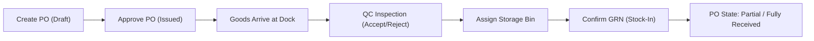
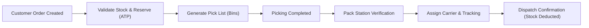

# 🏢 Enterprise Warehouse Management System (WMS)

<div align="center">


-brightgreen?logo=jest&logoColor=white)

**A high-performance, full-stack Warehouse Management System designed for multi-facility enterprise logistics, real-time inventory tracking, and end-to-end supply chain execution.**

[Live Frontend (Local)](http://localhost:5173) • [Backend API](http://localhost:5000) • [API Health](http://localhost:5000/api/health) • [Documentation](./docs/README.md)

</div>

---

## 📑 Table of Contents

- [Overview & Architecture](#-overview--architecture)
- [System Architecture Diagram](#-system-architecture-diagram)
- [Key Features & Modules](#-key-features--modules)
- [Fulfillment & Inventory Workflows](#-fulfillment--inventory-workflows)
- [Role-Based Access Control (RBAC) Matrix](#-role-based-access-control-rbac-matrix)
- [REST API Endpoints Reference](#-rest-api-endpoints-reference)
- [Automated Test Suite Verification (237/237)](#-automated-test-suite-verification-237237)
- [Getting Started & Local Setup](#-getting-started--local-setup)
- [Project Directory Structure](#-project-directory-structure)
- [Architectural Documentation Index](#-architectural-documentation-index)
- [License](#-license)

---

## 🌟 Overview & Architecture

This Enterprise Warehouse Management System (WMS) is engineered to solve modern supply chain challenges across inventory inaccuracy, fulfillment bottlenecks, and warehouse opacity. Built with a clean **modular architecture**, the platform guarantees:

1. **Triple-State Inventory Accounting:** Every SKU is tracked by **On-Hand**, **Reserved**, and **Available-to-Promise** ($ATP = OnHand - Reserved$) quantities at the specific storage bin level.
2. **Deterministic Stock Deductions:** Stock is deducted from on-hand balances **strictly once** at dispatch confirmation, preventing phantom stock and duplicate deductions.
3. **6-Level Spatial Hierarchy:** Warehouses are modeled down to the physical bin level: `Warehouse` $\rightarrow$ `Zone` $\rightarrow$ `Aisle` $\rightarrow$ `Rack` $\rightarrow$ `Shelf` $\rightarrow$ `Bin`.
4. **End-to-End Auditability:** Immutable stock movement ledgers, Goods Receipt Notes (GRNs), and entity-level audit logs with strict password hash scrubbing.
5. **Real Database Telemetry:** Dashboard charts, velocity graphs, and financial valuation metrics computed directly from SQL transactions with **zero hardcoded values**.

---

## 🏗️ System Architecture Diagram

```
+-------------------------------------------------------------------------------------------------+
|                                     React 18 Single Page App                                    |
|   Tailwind CSS  •  Lucide Icons  •  Responsive Shell  •  12 Interactive Operational Screens     |
+-------------------------------------------------------------------------------------------------+
                                                |  REST / JSON (JWT Bearer Token)
                                                v
+-------------------------------------------------------------------------------------------------+
|                                     Express API Gateway (v1)                                    |
|    Rate Limiting  •  CORS  •  JWT Auth Middleware  •  RBAC Guards  •  Zod Request Validation    |
+-------------------------------------------------------------------------------------------------+
                                                |
          +-------------------------------------+-------------------------------------+
          |                                     |                                     |
          v                                     v                                     v
+-------------------+                 +-------------------+                 +-------------------+
|    Master Data    |                 | Inventory Engine  |                 | Outbound & Inbound|
| Categories, SKUs, |                 | Triple-State,     |                 | POs, Receipts,    |
| Suppliers, Bins   |                 | Transfers, Adj.   |                 | Pick, Pack, Ship  |
+-------------------+                 +-------------------+                 +-------------------+
          |                                     |                                     |
          +-------------------------------------+-------------------------------------+
                                                |
                                                v
+-------------------------------------------------------------------------------------------------+
|                                        Prisma ORM v5                                            |
|   Atomic Transactions ($transaction)  •  Referential Integrity  •  In-Memory Sync Fallback Engine |
+-------------------------------------------------------------------------------------------------+
                                                |
                                                v
+-------------------------------------------------------------------------------------------------+
|                                         PostgreSQL 16                                           |
|       Relational Tables  •  Foreign Keys  •  Unique Constraints  •  Immutable Movement Logs     |
+-------------------------------------------------------------------------------------------------+
```

---

## 📦 Key Features & Modules

### 1. 🔐 Authentication & Session Security
- Cryptographic password hashing using `bcrypt` (10 salt rounds).
- Signed JWT access tokens with structured payload encoding user ID, email, and role.
- Active session tracking with instantaneous token revocation on logout.
- Sensitive data redaction: Plaintext passwords, tokens, and `$2[aby]\$...` hashes are scrubbed before API serialization.

### 2. 🗃️ Master Data & Spatial Hierarchy
- **Products:** Unique SKU validation, barcode scanning support, reorder thresholds, unit of measurement (UOM), and safe soft-deactivation.
- **Categories:** Parent-child hierarchy with foreign-key constraint deletion guards.
- **Suppliers:** Lead time monitoring, payment terms, and vendor contact records.
- **Warehouse Storage Hierarchy:** 6-tier spatial model (`WH-ZONE-AISLE-RACK-SHELF-BIN`) with automatic canonical barcode formatting and bin occupancy tracking.

### 3. 📊 Core Inventory Control Engine
- Real-time triple-state balances:
  $$\text{Available to Promise (ATP)} = \text{Quantity On-Hand} - \text{Quantity Reserved}$$
- Movement types: `STOCK_IN`, `STOCK_OUT`, `TRANSFER`, `ADJUSTMENT`.
- Audited stock adjustments requiring explicit reason codes and notes.
- Low-stock and safety-stock threshold breach notifications.
- Financial inventory valuation calculating SKU asset shares and total portfolio worth.

### 4. 📥 Purchasing & Inbound Goods Receiving (GRN)
- Purchase Orders (PO) linked to verified suppliers with line-item pricing.
- Support for partial deliveries, split shipments, and multiple receipt confirmations per PO.
- Dockside Quality Control (QC): Split tracking of **Accepted** and **Rejected** quantities with mandatory defect explanation notes.
- Over-receiving prevention guard: Rejects attempts to receive quantities beyond purchase limits (`422 Unprocessable Entity`).
- Direct-to-bin putaway location assignment updating live inventory immediately upon receipt.

### 5. 📤 Customer Orders & Fulfillment Engine
- Sales orders with customer details, shipping addresses, and requested delivery dates.
- Automatic stock validation and reservation holds upon order confirmation.
- Location-based picking tasks guiding warehouse operators to specific bins.
- Partial picking and scan-to-pack validation.
- Dispatch confirmation with carrier assignment, tracking number logging, and single-deduction stock reduction.
- Reservation release on cancellation preventing inventory lockup.

### 6. 📈 Dashboard Telemetry & Visual Analytics
- Real-time KPI summaries: Total SKUs, On-Hand Units, Reserved Stock, ATP, Pending POs, and Open Orders.
- Facility filter dropdown updating metrics dynamically across individual distribution centers.
- 7-day movement velocity bar chart comparing inbound receipts, outbound dispatches, and adjustments.
- Order pipeline stage distribution funnel.
- Top fast-moving SKU rankings.

### 7. 📑 Operational Reports & Security Audit Trail
- **8 Dedicated Report Categories:** Current Inventory, Stock Movements, Locations & Occupancy, Inbound Receiving, Customer Orders, Outbound Dispatch, Low-Stock Shortfall, and Financial Valuation.
- Multi-parameter filtering: Date range, product SKU, warehouse facility, and search queries.
- Instant CSV export (`text/csv`) with proper spreadsheet headers.
- Print-ready CSS stylesheets (`@media print`) optimized for physical floor pick-lists and packing slips.
- Security-scrubbed audit trail tracking user actions, entity types, timestamps, and state diffs.

---

## 🔄 Fulfillment & Inventory Workflows

### Inbound Receiving Flow


### Outbound Fulfillment Flow


---

## 🛡️ Role-Based Access Control (RBAC) Matrix

| Feature / Resource | System Admin | Warehouse Manager | Warehouse Staff |
| :--- | :---: | :---: | :---: |
| **View Dashboard & Inventory** | ✅ | ✅ | ✅ |
| **Receive Goods (GRN) & Putaway** | ✅ | ✅ | ✅ |
| **Pick, Pack & Process Shipments** | ✅ | ✅ | ✅ |
| **Perform Stock Adjustments** | ✅ | ✅ | ✅ (Audited) |
| **Create / Edit Master Products & Bins** | ✅ | ✅ | ❌ |
| **Create Purchase Orders & Sales Orders** | ✅ | ✅ | ❌ |
| **View Operational Reports (Ops)** | ✅ | ✅ | ✅ |
| **View Financial Valuation Reports** | ✅ | ✅ | ❌ (403 Forbidden) |
| **Inspect System Audit Logs** | ✅ | ✅ | ❌ (403 Forbidden) |
| **User Management (Create/Delete Users)** | ✅ | ❌ (403 Forbidden) | ❌ (403 Forbidden) |

---

## 🌐 REST API Endpoints Reference

All endpoints are prefixed with `/api/v1` and return standardized JSON response envelopes:
`{ "success": boolean, "data": any, "message"?: string }`

### Authentication & Users
| Method | Endpoint | Access | Description |
| :--- | :--- | :--- | :--- |
| `POST` | `/api/v1/auth/login` | Public | Authenticate user & issue signed JWT |
| `POST` | `/api/v1/auth/logout` | Authenticated | Revoke active session token |
| `GET` | `/api/v1/auth/me` | Authenticated | Fetch authenticated user profile |
| `GET` | `/api/v1/users` | Admin / Manager | List system users directory |
| `POST` | `/api/v1/users` | Admin Only | Create new system user |
| `DELETE`| `/api/v1/users/:id` | Admin Only | Deactivate user account |

### Master Data & Spatial Hierarchy
| Method | Endpoint | Access | Description |
| :--- | :--- | :--- | :--- |
| `GET/POST` | `/api/v1/categories` | Auth / Admin | List or create product categories |
| `GET/POST` | `/api/v1/products` | Auth / Admin | List or create master products (SKU) |
| `GET/POST` | `/api/v1/suppliers` | Auth / Admin | List or create supplier records |
| `GET/POST` | `/api/v1/warehouses` | Auth / Admin | List or create warehouse facilities |
| `GET/POST` | `/api/v1/locations` | Auth / Admin | List or generate 6-level storage bins |

### Core Inventory Engine
| Method | Endpoint | Access | Description |
| :--- | :--- | :--- | :--- |
| `GET` | `/api/v1/inventory` | All Roles | Query triple-state balances by bin/SKU |
| `POST` | `/api/v1/inventory/adjust` | All Roles | Record audited stock adjustment |
| `POST` | `/api/v1/inventory/transfer`| All Roles | Transfer stock between warehouse bins |
| `GET` | `/api/v1/inventory/movements`| All Roles | Query immutable movement ledger |
| `GET` | `/api/v1/inventory/valuation`| Admin/Manager | Calculate financial inventory valuation |

### Inbound Purchasing (PO & GRN)
| Method | Endpoint | Access | Description |
| :--- | :--- | :--- | :--- |
| `GET/POST` | `/api/v1/purchase-orders` | Manager/Admin | List or create purchase orders |
| `GET` | `/api/v1/purchase-orders/:id`| All Roles | Inspect PO details and line items |
| `POST` | `/api/v1/goods-receipts` | All Roles | Confirm receipt, QC inspection & putaway |
| `GET` | `/api/v1/goods-receipts` | All Roles | List historical Goods Receipt Notes |

### Outbound Orders & Fulfillment
| Method | Endpoint | Access | Description |
| :--- | :--- | :--- | :--- |
| `GET/POST` | `/api/v1/orders` | Manager/Admin | List or create customer sales orders |
| `POST` | `/api/v1/orders/:id/pick` | All Roles | Record location-based picking tasks |
| `POST` | `/api/v1/orders/:id/pack` | All Roles | Confirm packing station verification |
| `POST` | `/api/v1/orders/:id/dispatch`| All Roles | Confirm dispatch & trigger single deduction |
| `GET` | `/api/v1/shipments` | All Roles | Inspect completed outbound shipments |

### Analytics, Reports & Audit
| Method | Endpoint | Access | Description |
| :--- | :--- | :--- | :--- |
| `GET` | `/api/v1/analytics/dashboard`| All Roles | Live telemetry metrics & velocity trends |
| `GET` | `/api/v1/reports/:type` | Role Dependent | Generate one of 8 operational reports |
| `GET` | `/api/v1/reports/:type/export`| Role Dependent | Stream direct CSV spreadsheet download |
| `GET` | `/api/v1/analytics/audit-logs`| Admin/Manager | Query security-redacted audit logs |
| `GET` | `/api/v1/analytics/reconciliation`| Admin/Manager | Reconcile physical balances with ledger |

---

## 🧪 Automated Test Suite Verification (237/237)

The system includes automated integration and unit test suites covering every critical business rule, concurrent inventory lock, and security invariant. Run with:

```bash
npm test
```

### Test Suite Execution Summary

```
======================================================================
 WMS Enterprise Test Execution Summary                                
======================================================================
 ✓ Phase 2: Authentication & RBAC Suite ........... 23 / 23 Passed
 ✓ Phase 3: Master Data & Spatial Hierarchy ....... 25 / 25 Passed
 ✓ Phase 4: Core Inventory Engine & Ledger ........ 40 / 40 Passed
 ✓ Phase 5: Purchasing & Inbound Goods Receiving .. 32 / 32 Passed
 ✓ Phase 6: Customer Orders & Outbound Fulfillment  46 / 46 Passed
 ✓ Phase 7: Analytics, Reports & Audit Trail ...... 71 / 71 Passed
----------------------------------------------------------------------
 TOTAL: 237 / 237 Tests Passed (100% Pass Rate, 0 Failed) ✓
======================================================================
```

---

## 🚀 Getting Started & Local Setup

### 1. System Requirements
- **Node.js:** v18.18.0 or v20.x LTS (Recommended)
- **npm:** v9.x or higher
- **Git**

### 2. Clone and Install
```bash
# Clone the repository
git clone https://github.com/JIMRIS2330/WHS_WAREHOUSE-MANAGEMENT-SYSTEM.git
cd WHS_WAREHOUSE-MANAGEMENT-SYSTEM

# Install dependencies for all workspaces
npm install
npm --prefix server install
npm --prefix client install
```

### 3. Environment Setup
Both the backend and frontend include safe `.env.example` templates:

```bash
# Server configuration (.env)
cp server/.env.example server/.env

# Client configuration (.env)
cp client/.env.example client/.env
```

### 4. Running the Development Servers
```bash
# Start backend and frontend concurrently
npm run dev:all

# Or start services in separate terminals:
npm run dev:server  # API running on http://localhost:5000
npm run dev:client  # Vite React App on http://localhost:5173
```

### 5. Pre-Seeded Demonstration Accounts

| Role | Username / Email | Password | Access Level |
| :--- | :--- | :--- | :--- |
| **System Admin** | `admin@wms.local` | `Admin123!` | Full unrestricted system access |
| **Warehouse Manager** | `manager@wms.local` | `Manager123!` | Operations, purchasing, orders, and reports |
| **Warehouse Staff** | `staff@wms.local` | `Staff123!` | Floor operations (receiving, picking, packing) |

---

## 📁 Project Directory Structure

```
WHS_WAREHOUSE-MANAGEMENT-SYSTEM/
├── client/                          # React + TypeScript + Vite Frontend
│   ├── src/
│   │   ├── api/                     # Typed Axios/Fetch API client modules
│   │   │   ├── analytics.ts
│   │   │   ├── fulfillment.ts
│   │   │   ├── inventory.ts
│   │   │   ├── masterData.ts
│   │   │   └── purchasing.ts
│   │   ├── components/ui/           # Reusable Tailwind component library
│   │   │   ├── Alert.tsx, Badge.tsx, Button.tsx, Card.tsx
│   │   │   ├── Input.tsx, Modal.tsx, Table.tsx, LoadingSpinner.tsx
│   │   ├── context/                 # AuthContext & Session state management
│   │   ├── layouts/                 # DashboardLayout (Sidebar, Navbar, Profile)
│   │   ├── pages/                   # 12 Interactive Module Screens
│   │   │   ├── CategoriesPage.tsx   ├── ProductsPage.tsx
│   │   │   ├── DashboardPage.tsx    ├── ReceivingPage.tsx
│   │   │   ├── DispatchPage.tsx     ├── ReportsPage.tsx
│   │   │   ├── InventoryPage.tsx    ├── SettingsPage.tsx
│   │   │   ├── LoginPage.tsx        ├── SuppliersPage.tsx
│   │   │   ├── OrdersPage.tsx       ├── UsersPage.tsx
│   │   │   └── WarehousesPage.tsx
│   │   ├── types/                   # Frontend TypeScript interfaces
│   │   ├── App.tsx                  # Protected route definitions
│   │   └── main.tsx                 # React DOM mount point
│   ├── tailwind.config.js
│   └── vite.config.ts
├── server/                          # Node.js + Express + TypeScript Backend
│   ├── prisma/
│   │   ├── migrations/              # Phased relational SQL migrations
│   │   ├── schema.prisma            # Relational database schema
│   │   └── seed.ts                  # Safe development seed script
│   ├── src/
│   │   ├── config/                  # Prisma and environment configurations
│   │   ├── middleware/              # JWT verification, RBAC, error handling
│   │   ├── modules/                 # Modular domain architecture
│   │   │   ├── analytics/           # Reports, dashboard queries, CSV export
│   │   │   ├── auth/                # Hashing, token issuance, session control
│   │   │   ├── fulfillment/         # Sales orders, picking, packing, dispatch
│   │   │   ├── inventory/           # Triple-state balances, transfers, ledger
│   │   │   ├── masterData/          # Products, categories, suppliers, bins
│   │   │   ├── purchasing/          # Purchase orders, GRN, quality inspection
│   │   │   └── users/               # User directory & profile controllers
│   │   ├── routes/                  # Express v1 router mounts
│   │   ├── tests/                   # 6 Automated Integration Test Suites
│   │   │   ├── analytics.test.ts    ├── masterData.test.ts
│   │   │   ├── auth.test.ts         ├── purchasing.test.ts
│   │   │   └── fulfillment.test.ts  └── inventory.test.ts
│   │   ├── utils/                   # Security hashing and secret scrubbing
│   │   ├── app.ts                   # Express application setup
│   │   └── server.ts                # HTTP server listener
│   └── tsconfig.json
├── docs/                            # Architectural Documentation Suite
│   ├── 01_PROJECT_CHARTER_AND_PROBLEM_STATEMENT.md
│   ├── 02_REQUIREMENTS_SPECIFICATION.md
│   ├── 03_SYSTEM_ARCHITECTURE.md
│   ├── 04_DATABASE_SCHEMA_AND_ERD.md
│   ├── 05_API_SPECIFICATION_PLAN.md
│   ├── 06_BUSINESS_RULES_AND_WORKFLOWS.md
│   ├── 07_RISKS_ASSUMPTIONS_AND_MITIGATION.md
│   ├── 08_DEVELOPMENT_ROADMAP.md
│   └── README.md
├── .gitignore                       # Multi-workspace Git ignore rules
├── package.json                     # Monorepo scripts & workspaces
└── README.md                        # Master Project Documentation
```

---

## 📚 Architectural Documentation Index

Complete technical documents created during the architectural design phase are stored in [`docs/`](./docs):

- **[01. Project Charter & Problem Statement](./docs/01_PROJECT_CHARTER_AND_PROBLEM_STATEMENT.md):** Business rationale, operational challenges, and ROI goals.
- **[02. Requirements Specification](./docs/02_REQUIREMENTS_SPECIFICATION.md):** 13 core functional modules and enterprise non-functional standards.
- **[03. System Architecture](./docs/03_SYSTEM_ARCHITECTURE.md):** Modular monolith architecture, cross-cutting concerns, and transaction boundaries.
- **[04. Database Schema & ERD](./docs/04_DATABASE_SCHEMA_AND_ERD.md):** Relational PostgreSQL schema, indexes, and entity relationships.
- **[05. API Specification Plan](./docs/05_API_SPECIFICATION_PLAN.md):** REST resource endpoints, request/response formats, and status codes.
- **[06. Business Rules & Workflows](./docs/06_BUSINESS_RULES_AND_WORKFLOWS.md):** Inventory arithmetic, over-receiving guards, and dispatch invariants.
- **[07. Risks, Assumptions & Mitigation](./docs/07_RISKS_ASSUMPTIONS_AND_MITIGATION.md):** Concurrency race conditions, deadlock avoidance, and log scalability.
- **[08. Development Roadmap](./docs/08_DEVELOPMENT_ROADMAP.md):** Phased milestone breakdown from foundation to production.

---

## 📄 License

This project is licensed under the **MIT License**. Feel free to use, modify, and distribute for commercial or private warehouse management deployments.
