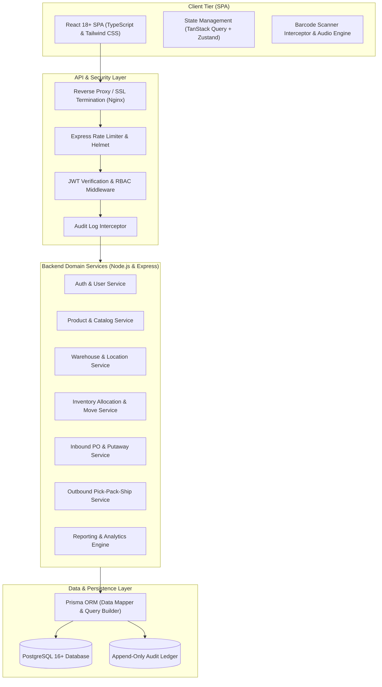

# 03. System Architecture Document

## 1. Architectural Philosophy & Overview

The **Warehouse Management System (WMS)** is engineered as a **Modular Monolith** designed for high transactional consistency, developer velocity, and operational simplicity. In physical warehousing, inventory data consistency is mission-critical: phantom stock or negative inventory balances immediately disrupt physical supply chains. Therefore, our architecture emphasizes **ACID transactional integrity**, strict layer separation, and strongly typed end-to-end contracts.



---

## 2. Technology Stack & Decision Matrix

| Layer | Chosen Technology | Version / Tooling | Architectural Justification |
| :--- | :--- | :--- | :--- |
| **Frontend Framework** | **React** with **TypeScript** | React 18+, TS 5.x | Declarative UI, high component reusability, strict compile-time type safety preventing UI runtime crashes during warehouse floor operations. |
| **Styling & Design System** | **Tailwind CSS** | Tailwind v3.4+ | High performance, zero runtime overhead, responsive utility classes tailored for both rugged handheld barcode scanners (7-inch) and desktop management displays (1080p/4K). |
| **Client State & Caching** | **TanStack Query** (React Query) + **Zustand** | Query v5, Zustand v4 | Optimistic UI updates for scanner workflows, automatic background cache invalidation, and lightweight global state without Redux boilerplate. |
| **Backend Runtime** | **Node.js** | v20 LTS | Non-blocking asynchronous I/O, vast ecosystem, native JSON handling, seamless sharing of TypeScript interfaces between client and server. |
| **API Framework** | **Express.js** | v4.19+ | Lightweight, battle-tested, unopinionated routing with standardized middleware chaining for auth, validation, and error handling. |
| **ORM & Data Modeling** | **Prisma** | v5.x | Automated schema migrations, type-safe query generation, native transaction management (`$transaction`), and deep relational joins without raw SQL vulnerability. |
| **Database Engine** | **PostgreSQL** | v16+ | Enterprise-grade ACID compliance, strict foreign key constraints, JSONB support for audit diffs, row-level locking (`SELECT ... FOR UPDATE`) critical for stock allocation. |
| **Input Validation** | **Zod** | v3.x | End-to-end schema validation for API request bodies, query params, and environment variables with automatic TypeScript type inference. |
| **Security & Auth** | **JWT & Argon2 / bcrypt** | jsonwebtoken, argon2 | Stateless short-lived JWT access tokens + HTTP-only secure refresh tokens, cryptographic password hashing. |

---

## 3. High-Level Layered Architecture

The system implements a classic 4-tier Clean Layered Architecture:

```
+-------------------------------------------------------------------+
|                        1. Presentation Layer                      |
|  - React SPA Views, Dashboard Widgets, Responsive Barcode Modals  |
|  - Express REST Controllers, Request Parsers, Response Envelopes  |
+-------------------------------------------------------------------+
                                  |
                                  v
+-------------------------------------------------------------------+
|                          2. Security Layer                        |
|  - JWT Authentication, Session Renewal, Role-Based Access Control |
|  - Request Rate Limiting, Input Sanitization, Helmet Headers      |
+-------------------------------------------------------------------+
                                  |
                                  v
+-------------------------------------------------------------------+
|                          3. Business Domain                       |
|  - Inventory Allocation Engine (FIFO / FEFO Algorithms)           |
|  - Putaway Logic (ABC Velocity & Volumetric Optimization)         |
|  - Order Fulfillment State Machine (Pending -> Shipped)          |
|  - Stock Movement & Rebalance Coordinator                         |
+-------------------------------------------------------------------+
                                  |
                                  v
+-------------------------------------------------------------------+
|                      4. Data Access & Persistence                 |
|  - Prisma Repositories, Atomic Transactions, Unit of Work         |
|  - PostgreSQL Relational Tables, Indexes, Triggers, Constraints   |
+-------------------------------------------------------------------+
```

---

## 4. Frontend Architecture

### 4.1 Component Tree & Page Hierarchy
The client application is organized into layout shells and domain-driven feature modules:

- **App Root:**
  - `AuthProvider` (Token refresh, current user context, permission checks)
  - `QueryClientProvider` (TanStack Query cache configuration)
  - `ToastProvider` / `AudioFeedbackProvider` (Audio chimes for successful/failed barcode scans)
  - `AppRouter` (Protected routes guarded by RBAC wrappers)

- **Layouts:**
  - `DashboardLayout` (Collapsible sidebar navigation, top header, warehouse selector, notification center)
  - `AuthLayout` (Clean, centered login/password-reset card)
  - `ScannerModeLayout` (Full-screen, high-contrast, touch-optimized UI for handheld terminals)

- **Feature Modules:**
  - `features/auth/`
  - `features/dashboard/`
  - `features/products/`
  - `features/warehouses/`
  - `features/locations/`
  - `features/inventory/`
  - `features/receiving/`
  - `features/orders/`
  - `features/dispatch/`
  - `features/reports/`
  - `features/audit/`

### 4.2 Barcode & Handheld Optimization
- Global keyboard hook to detect hardware barcode scanner input (rapid sequence keystrokes followed by Enter key within < 50ms).
- Instant audio feedback (positive high-pitch chime on valid scan, low error buzz on invalid SKU/bin).
- Auto-focus management so warehouse operators never have to tap input fields manually.

---

## 5. Backend Architecture & Domain Services

### 5.1 Service Decoupling & Interfaces
Each domain is isolated into its own folder structure containing:
1. `*.routes.ts` - Express router defining HTTP verbs and middleware chains.
2. `*.controller.ts` - HTTP request extraction, Zod validation invocation, and HTTP response formatting.
3. `*.service.ts` - Pure business logic, orchestration of multi-table operations, and transaction wrapping.
4. `*.schema.ts` - Zod validation schemas for request body, query params, and URL route parameters.

### 5.2 Concurrency & Inventory Allocation Strategy
To prevent double-allocation of stock during high-volume order surges, the `InventoryService` utilizes PostgreSQL row-level locks via Prisma:
```typescript
// Architectural pattern for atomic allocation
await prisma.$transaction(async (tx) => {
  // 1. Lock candidate inventory records using SELECT ... FOR UPDATE
  const availableStock = await tx.$queryRaw`
    SELECT id, "quantityOnHand", "quantityReserved"
    FROM "InventoryItem"
    WHERE "productId" = ${productId} 
      AND "warehouseId" = ${warehouseId}
      AND ("quantityOnHand" - "quantityReserved") >= ${requestedQty}
    ORDER BY "expiryDate" ASC NULLS LAST, "createdAt" ASC
    FOR UPDATE
  `;
  
  // 2. Validate availability and update reservation atomically
  // 3. Create OrderAllocation record
  // 4. Write immutable AuditLog entry
});
```

---

## 6. Security & Authentication Architecture

1. **Token Flow:**
   - **Login:** Client posts credentials -> Server validates Argon2 hash -> Server returns JSON `{ accessToken, user }` and sets an `httpOnly`, `secure`, `sameSite: 'strict'` cookie containing the `refreshToken`.
   - **API Requests:** Client attaches `Authorization: Bearer <accessToken>` in headers.
   - **Token Expiry:** On `401 Unauthorized`, an Axios/Fetch response interceptor catches the error, calls `/api/v1/auth/refresh`, updates the in-memory access token, and transparently retries the failed request.
   - **Logout:** Server revokes the refresh token record in the database and clears the browser cookie.

2. **Authorization Middleware:**
   - Declarative middleware: `authorize(['ADMIN', 'WAREHOUSE_MANAGER'])` verifies that `req.user.role` contains sufficient privilege before invoking downstream controllers.

---

## 7. Recommended Directory Structure (Monorepo Layout)

```
warehouse-management-system/
├── docs/                               # Comprehensive architecture documentation
│   ├── 01_PROJECT_CHARTER_AND_PROBLEM_STATEMENT.md
│   ├── 02_REQUIREMENTS_SPECIFICATION.md
│   ├── 03_SYSTEM_ARCHITECTURE.md
│   ├── 04_DATABASE_SCHEMA_AND_ERD.md
│   ├── 05_API_SPECIFICATION_PLAN.md
│   ├── 06_BUSINESS_RULES_AND_WORKFLOWS.md
│   ├── 07_RISKS_ASSUMPTIONS_AND_MITIGATION.md
│   ├── 08_DEVELOPMENT_ROADMAP.md
│   └── README.md
├── client/                             # React + TypeScript + Tailwind Frontend
│   ├── public/                         # Static assets, sound chimes, favicon
│   ├── src/
│   │   ├── api/                        # Axios instance, API client functions
│   │   ├── components/                 # Shared UI library (Button, Modal, Table, Badge, etc.)
│   │   ├── context/                    # AuthContext, NotificationContext
│   │   ├── features/                   # 13 Domain Modules (components, hooks, pages)
│   │   │   ├── auth/
│   │   │   ├── dashboard/
│   │   │   ├── products/
│   │   │   ├── categories/
│   │   │   ├── suppliers/
│   │   │   ├── warehouses/
│   │   │   ├── locations/
│   │   │   ├── inventory/
│   │   │   ├── receiving/
│   │   │   ├── orders/
│   │   │   ├── dispatch/
│   │   │   ├── reports/
│   │   │   └── audit/
│   │   ├── hooks/                      # Custom hooks (useScanner, useDebounce, etc.)
│   │   ├── layouts/                    # DashboardLayout, AuthLayout, ScannerLayout
│   │   ├── routes/                     # React Router definition & Route Guards
│   │   ├── types/                      # Frontend TypeScript models & DTOs
│   │   ├── utils/                      # Formatters, barcode helpers, calculations
│   │   ├── App.tsx                     # App root
│   │   └── main.tsx                    # React entrypoint
│   ├── index.html
│   ├── package.json
│   ├── tailwind.config.js
│   ├── tsconfig.json
│   └── vite.config.ts
├── server/                             # Node.js + Express + Prisma Backend
│   ├── prisma/
│   │   ├── schema.prisma               # Complete PostgreSQL Prisma schema
│   │   ├── seed.ts                     # Database seeding script (roles, admin, sample warehouse)
│   │   └── migrations/                 # Versioned SQL migrations
│   ├── src/
│   │   ├── config/                     # Environment variables (Zod validated), DB client
│   │   ├── constants/                  # Status enums, error codes, HTTP codes
│   │   ├── middleware/                 # Auth, RBAC, ErrorHandler, Logger, RateLimiter
│   │   ├── modules/                    # Modular feature controllers, services, routes
│   │   │   ├── auth/
│   │   │   ├── dashboard/
│   │   │   ├── products/
│   │   │   ├── categories/
│   │   │   ├── suppliers/
│   │   │   ├── warehouses/
│   │   │   ├── locations/
│   │   │   ├── inventory/
│   │   │   ├── receiving/
│   │   │   ├── orders/
│   │   │   ├── dispatch/
│   │   │   ├── reports/
│   │   │   └── audit/
│   │   ├── utils/                      # Token helpers, Logger (Winston), PDF generator
│   │   ├── app.ts                      # Express app configuration & middleware pipeline
│   │   └── server.ts                   # Server bootstrap & graceful shutdown handler
│   ├── package.json
│   ├── tsconfig.json
│   └── .env.example
├── docker-compose.yml                  # Local development stack (PostgreSQL + App)
└── README.md                           # Project quickstart and developer guide
```
