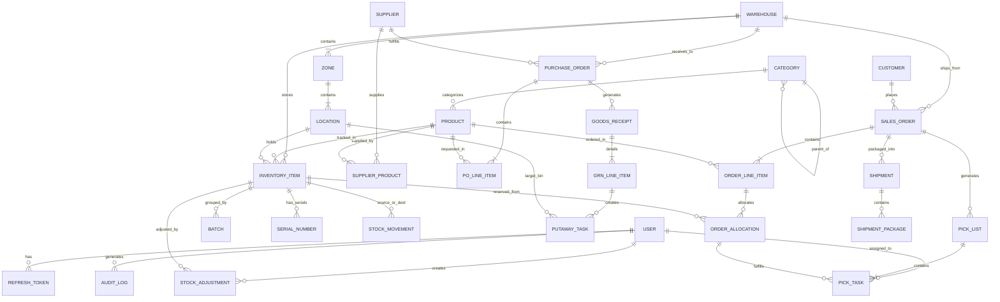

# 04. Database Schema & Entity-Relationship Diagram (ERD)

## 1. Overview & Data Modeling Principles

The Warehouse Management System database schema is built on **PostgreSQL** using **Prisma ORM**. It is structured to satisfy three core non-negotiable principles:
1. **Mathematical Accuracy:** Quantities, dimensions, and costs use precise numeric types (`Decimal(12, 4)` and `Decimal(10, 2)`) to eliminate floating-point drift.
2. **Zero Orphaned Stock:** Strict foreign key constraints with `RESTRICT` on products, bins, and warehouses prevent cascading deletions that could corrupt inventory ledgers.
3. **Immutable Historical Auditability:** State changes produce point-in-time snapshot records (`StockMovement`, `AuditLog`, `GRNLineItem`) rather than just in-place overwrites.

---

## 2. Entity-Relationship Diagram (ERD)



---

## 3. Comprehensive Prisma Schema Definition

```prisma
// =============================================================================
// PRISMA SCHEMA FOR ENTERPRISE WAREHOUSE MANAGEMENT SYSTEM (WMS)
// =============================================================================

datasource db {
  provider = "postgresql"
  url      = env("DATABASE_URL")
}

generator client {
  provider = "prisma-client-js"
}

// -----------------------------------------------------------------------------
// ENUMS
// -----------------------------------------------------------------------------

enum UserRole {
  SUPER_ADMIN
  WAREHOUSE_MANAGER
  INVENTORY_CONTROLLER
  INBOUND_OPERATOR
  OUTBOUND_OPERATOR
  AUDITOR
}

enum StorageClass {
  AMBIENT
  COLD_STORAGE
  FROZEN
  HAZARDOUS
  HIGH_VALUE
  FRAGILE
}

enum UnitOfMeasure {
  EACH
  PIECE
  BOX
  CARTON
  PALLET
  KILOGRAM
  METER
  LITER
}

enum ZoneType {
  RECEIVING_DOCK
  STAGING
  BULK_STORAGE
  PICK_FACE
  PACKING_STATION
  SHIPPING_DOCK
  QUALITY_CONTROL
  QUARANTINE
  RETURNS
}

enum POStatus {
  DRAFT
  ISSUED
  PARTIALLY_RECEIVED
  RECEIVED
  CLOSED
  CANCELLED
}

enum PutawayStatus {
  PENDING
  ASSIGNED
  IN_PROGRESS
  COMPLETED
  CANCELLED
}

enum OrderStatus {
  PENDING
  ALLOCATED
  PARTIALLY_ALLOCATED
  PICKING
  PICKED
  PACKING
  PACKED
  DISPATCHED
  DELIVERED
  CANCELLED
}

enum OrderPriority {
  LOW
  STANDARD
  HIGH
  URGENT
}

enum PickListStatus {
  OPEN
  ASSIGNED
  IN_PROGRESS
  COMPLETED
  CANCELLED
}

enum PickTaskStatus {
  PENDING
  PICKED
  SHORT_PICKED
  SKIPPED
}

enum ShipmentStatus {
  MANIFESTED
  READY_FOR_PICKUP
  IN_TRANSIT
  DELIVERED
  EXCEPTION
}

enum AdjustmentReason {
  DAMAGED_GOODS
  EXPIRED_STOCK
  CYCLE_COUNT_DISCREPANCY
  THEFT_OR_SHRINKAGE
  FOUND_STOCK
  DATA_ENTRY_CORRECTION
  SCRAP
}

enum MovementType {
  INBOUND_RECEIPT
  PUTAWAY
  INTERNAL_TRANSFER
  REPLENISHMENT
  PICK_ALLOCATION
  DISPATCH_SHIPMENT
  STOCK_ADJUSTMENT
  RETURN_RESTOCK
}

enum AuditAction {
  CREATE
  UPDATE
  DELETE
  ADJUST
  TRANSFER
  ALLOCATE
  LOGIN_SUCCESS
  LOGIN_FAILURE
}

// -----------------------------------------------------------------------------
// 1. AUTHENTICATION & USERS
// -----------------------------------------------------------------------------

model User {
  id           String        @id @default(uuid())
  email        String        @unique
  passwordHash String
  firstName    String
  lastName     String
  role         UserRole      @default(OUTBOUND_OPERATOR)
  isActive     Boolean       @default(true)
  phone        String?
  createdAt    DateTime      @default(now())
  updatedAt    DateTime      @updatedAt

  assignedWarehouseId String?
  assignedWarehouse   Warehouse?  @relation(fields: [assignedWarehouseId], references: [id], onDelete: SetNull)

  refreshTokens    RefreshToken[]
  auditLogs        AuditLog[]
  stockAdjustments StockAdjustment[]
  assignedPicks    PickList[]        @relation("AssignedPicker")
  putawayTasks     PutawayTask[]     @relation("AssignedPutaway")

  @@index([email])
  @@index([role])
}

model RefreshToken {
  id        String   @id @default(uuid())
  token     String   @unique
  userId    String
  user      User     @relation(fields: [userId], references: [id], onDelete: Cascade)
  isRevoked Boolean  @default(false)
  expiresAt DateTime
  createdAt DateTime @default(now())

  @@index([userId])
}

// -----------------------------------------------------------------------------
// 2. PRODUCTS & CATEGORIES
// -----------------------------------------------------------------------------

model Category {
  id          String     @id @default(uuid())
  name        String     @unique
  code        String     @unique
  description String?
  parentId    String?
  parent      Category?  @relation("SubCategories", fields: [parentId], references: [id], onDelete: SetNull)
  children    Category[] @relation("SubCategories")
  products    Product[]
  createdAt   DateTime   @default(now())
  updatedAt   DateTime   @updatedAt

  @@index([parentId])
}

model Product {
  id              String        @id @default(uuid())
  sku             String        @unique
  barcode         String        @unique
  name            String
  description     String?
  categoryId      String
  category        Category      @relation(fields: [categoryId], references: [id], onDelete: Restrict)
  uom             UnitOfMeasure @default(EACH)
  storageClass    StorageClass  @default(AMBIENT)
  
  // Physical Metrics
  lengthCm        Decimal?      @db.Decimal(8, 2)
  widthCm         Decimal?      @db.Decimal(8, 2)
  heightCm        Decimal?      @db.Decimal(8, 2)
  weightKg        Decimal?      @db.Decimal(8, 3)

  // Financials
  costPrice       Decimal       @db.Decimal(12, 2)
  sellingPrice    Decimal       @db.Decimal(12, 2)

  // Replenishment Thresholds
  reorderPoint    Int           @default(10)
  reorderQuantity Int           @default(50)
  minStockLevel   Int           @default(5)
  maxStockLevel   Int           @default(1000)

  // Flags
  requiresBatch   Boolean       @default(false)
  requiresSerial  Boolean       @default(false)
  isActive        Boolean       @default(true)

  createdAt       DateTime      @default(now())
  updatedAt       DateTime      @updatedAt

  inventoryItems   InventoryItem[]
  supplierProducts SupplierProduct[]
  poLineItems      POLineItem[]
  orderLineItems   OrderLineItem[]
  stockMovements   StockMovement[]

  @@index([sku])
  @@index([barcode])
  @@index([categoryId])
}

// -----------------------------------------------------------------------------
// 3. SUPPLIERS
// -----------------------------------------------------------------------------

model Supplier {
  id            String            @id @default(uuid())
  code          String            @unique
  name          String
  contactName   String?
  email         String
  phone         String
  address       String
  city          String
  country       String
  leadTimeDays  Int               @default(7)
  paymentTerms  String?
  isActive      Boolean           @default(true)
  createdAt     DateTime          @default(now())
  updatedAt     DateTime          @updatedAt

  products       SupplierProduct[]
  purchaseOrders PurchaseOrder[]

  @@index([code])
}

model SupplierProduct {
  id            String   @id @default(uuid())
  supplierId    String
  supplier      Supplier @relation(fields: [supplierId], references: [id], onDelete: Cascade)
  productId     String
  product       Product  @relation(fields: [productId], references: [id], onDelete: Cascade)
  supplierSku   String?
  purchasePrice Decimal  @db.Decimal(12, 2)
  leadTimeDays  Int?

  @@unique([supplierId, productId])
}

// -----------------------------------------------------------------------------
// 4. WAREHOUSES & LOCATIONS HIERARCHY
// -----------------------------------------------------------------------------

model Warehouse {
  id          String   @id @default(uuid())
  code        String   @unique
  name        String
  address     String
  city        String
  state       String?
  country     String
  postalCode  String
  timezone    String   @default("UTC")
  totalAreaM2 Decimal? @db.Decimal(10, 2)
  isActive    Boolean  @default(true)
  createdAt   DateTime @default(now())
  updatedAt   DateTime @updatedAt

  zones          Zone[]
  locations      Location[]
  inventoryItems InventoryItem[]
  purchaseOrders PurchaseOrder[]
  salesOrders    SalesOrder[]
  assignedUsers  User[]

  @@index([code])
}

model Zone {
  id          String     @id @default(uuid())
  warehouseId String
  warehouse   Warehouse  @relation(fields: [warehouseId], references: [id], onDelete: Cascade)
  code        String
  name        String
  type        ZoneType   @default(BULK_STORAGE)
  isTemperatureControlled Boolean @default(false)
  createdAt   DateTime   @default(now())
  updatedAt   DateTime   @updatedAt

  locations Location[]

  @@unique([warehouseId, code])
  @@index([warehouseId])
}

model Location {
  id          String       @id @default(uuid())
  warehouseId String
  warehouse   Warehouse    @relation(fields: [warehouseId], references: [id], onDelete: Cascade)
  zoneId      String
  zone        Zone         @relation(fields: [zoneId], references: [id], onDelete: Cascade)
  
  barcode     String       @unique // e.g. WH1-Z01-A01-R01-S01-B01
  aisle       String
  rack        String
  shelf       String
  bin         String

  pickSequence Int         @default(100) // Route sequencing index
  maxWeightKg  Decimal?    @db.Decimal(8, 2)
  maxVolumeM3  Decimal?    @db.Decimal(8, 3)
  isOccupied   Boolean     @default(false)
  isLocked     Boolean     @default(false) // For stock count or quarantine

  createdAt   DateTime     @default(now())
  updatedAt   DateTime     @updatedAt

  inventoryItems   InventoryItem[]
  putawayTasks     PutawayTask[]
  destMovements    StockMovement[] @relation("DestLocation")
  sourceMovements  StockMovement[] @relation("SourceLocation")

  @@unique([warehouseId, aisle, rack, shelf, bin])
  @@index([barcode])
  @@index([zoneId])
}

// -----------------------------------------------------------------------------
// 5. INVENTORY & STOCK BALANCES
// -----------------------------------------------------------------------------

model InventoryItem {
  id               String       @id @default(uuid())
  warehouseId      String
  warehouse        Warehouse    @relation(fields: [warehouseId], references: [id], onDelete: Restrict)
  locationId       String
  location         Location     @relation(fields: [locationId], references: [id], onDelete: Restrict)
  productId        String
  product          Product      @relation(fields: [productId], references: [id], onDelete: Restrict)

  batchId          String?
  batch            Batch?       @relation(fields: [batchId], references: [id], onDelete: SetNull)

  // Balances
  quantityOnHand   Decimal      @default(0) @db.Decimal(12, 4)
  quantityReserved Decimal      @default(0) @db.Decimal(12, 4) // For active picks

  createdAt        DateTime     @default(now())
  updatedAt        DateTime     @updatedAt

  serialNumbers    SerialNumber[]
  orderAllocations OrderAllocation[]
  stockAdjustments StockAdjustment[]

  @@unique([warehouseId, locationId, productId, batchId])
  @@index([warehouseId, productId])
  @@index([locationId])
  @@index([batchId])
}

model Batch {
  id               String          @id @default(uuid())
  batchNumber      String          @unique
  manufacturingDate DateTime?
  expiryDate       DateTime
  supplierLotNumber String?
  isQuarantined    Boolean         @default(false)
  createdAt        DateTime        @default(now())

  inventoryItems   InventoryItem[]

  @@index([batchNumber])
  @@index([expiryDate])
}

model SerialNumber {
  id              String        @id @default(uuid())
  inventoryItemId String
  inventoryItem   InventoryItem @relation(fields: [inventoryItemId], references: [id], onDelete: Cascade)
  serialNumber    String        @unique
  status          String        @default("AVAILABLE") // AVAILABLE, RESERVED, SHIPPED
  createdAt       DateTime      @default(now())

  @@index([serialNumber])
}

model StockAdjustment {
  id              String           @id @default(uuid())
  inventoryItemId String
  inventoryItem   InventoryItem    @relation(fields: [inventoryItemId], references: [id], onDelete: Restrict)
  adjustedByUserId String
  adjustedByUser  User             @relation(fields: [adjustedByUserId], references: [id], onDelete: Restrict)
  
  previousQuantity Decimal         @db.Decimal(12, 4)
  newQuantity      Decimal         @db.Decimal(12, 4)
  deltaQuantity    Decimal         @db.Decimal(12, 4)
  reasonCode       AdjustmentReason
  notes            String?
  createdAt        DateTime        @default(now())

  @@index([inventoryItemId])
  @@index([adjustedByUserId])
}

model StockMovement {
  id               String       @id @default(uuid())
  productId        String
  product          Product      @relation(fields: [productId], references: [id], onDelete: Restrict)
  sourceLocationId String?
  sourceLocation   Location?    @relation("SourceLocation", fields: [sourceLocationId], references: [id], onDelete: SetNull)
  destLocationId   String?
  destLocation     Location?    @relation("DestLocation", fields: [destLocationId], references: [id], onDelete: SetNull)
  
  quantity         Decimal      @db.Decimal(12, 4)
  movementType     MovementType
  referenceId      String?      // Reference to PO, Order, or Adjustment ID
  performedByUserId String?
  createdAt        DateTime     @default(now())

  @@index([productId])
  @@index([referenceId])
  @@index([createdAt])
}

// -----------------------------------------------------------------------------
// 6. INBOUND RECEIVING & PUTAWAY
// -----------------------------------------------------------------------------

model PurchaseOrder {
  id           String        @id @default(uuid())
  poNumber     String        @unique
  supplierId   String
  supplier     Supplier      @relation(fields: [supplierId], references: [id], onDelete: Restrict)
  warehouseId  String
  warehouse    Warehouse     @relation(fields: [warehouseId], references: [id], onDelete: Restrict)
  
  status       POStatus      @default(DRAFT)
  expectedDate DateTime?
  totalAmount  Decimal       @default(0) @db.Decimal(12, 2)
  notes        String?
  createdAt    DateTime      @default(now())
  updatedAt    DateTime      @updatedAt

  lineItems    POLineItem[]
  receipts     GoodsReceipt[]

  @@index([poNumber])
  @@index([supplierId])
  @@index([warehouseId])
}

model POLineItem {
  id             String        @id @default(uuid())
  purchaseOrderId String
  purchaseOrder  PurchaseOrder @relation(fields: [purchaseOrderId], references: [id], onDelete: Cascade)
  productId      String
  product        Product       @relation(fields: [productId], references: [id], onDelete: Restrict)
  
  quantityOrdered  Decimal     @db.Decimal(12, 4)
  quantityReceived Decimal     @default(0) @db.Decimal(12, 4)
  unitCost         Decimal     @db.Decimal(12, 2)

  grnLineItems   GRNLineItem[]

  @@unique([purchaseOrderId, productId])
}

model GoodsReceipt {
  id              String        @id @default(uuid())
  grnNumber       String        @unique // Goods Receipt Note
  purchaseOrderId String
  purchaseOrder   PurchaseOrder @relation(fields: [purchaseOrderId], references: [id], onDelete: Restrict)
  receivedAt      DateTime      @default(now())
  carrierName     String?
  billOfLading    String?
  receivedByUserId String

  lineItems       GRNLineItem[]

  @@index([grnNumber])
}

model GRNLineItem {
  id             String       @id @default(uuid())
  goodsReceiptId String
  goodsReceipt   GoodsReceipt @relation(fields: [goodsReceiptId], references: [id], onDelete: Cascade)
  poLineItemId   String
  poLineItem     POLineItem   @relation(fields: [poLineItemId], references: [id], onDelete: Restrict)
  
  quantityAccepted Decimal    @db.Decimal(12, 4)
  quantityRejected Decimal    @default(0) @db.Decimal(12, 4)
  batchNumber      String?
  expiryDate       DateTime?
  rejectionReason  String?

  putawayTasks     PutawayTask[]
}

model PutawayTask {
  id              String        @id @default(uuid())
  grnLineItemId   String
  grnLineItem     GRNLineItem   @relation(fields: [grnLineItemId], references: [id], onDelete: Cascade)
  targetLocationId String
  targetLocation  Location      @relation(fields: [targetLocationId], references: [id], onDelete: Restrict)
  
  quantity        Decimal       @db.Decimal(12, 4)
  status          PutawayStatus @default(PENDING)
  assignedToUserId String?
  assignedToUser  User?         @relation("AssignedPutaway", fields: [assignedToUserId], references: [id], onDelete: SetNull)
  completedAt     DateTime?
  createdAt       DateTime      @default(now())

  @@index([status])
  @@index([targetLocationId])
}

// -----------------------------------------------------------------------------
// 7. ORDERS & ALLOCATION
// -----------------------------------------------------------------------------

model Customer {
  id          String       @id @default(uuid())
  code        String       @unique
  name        String
  email       String
  phone       String
  address     String
  city        String
  country     String
  createdAt   DateTime     @default(now())

  orders      SalesOrder[]
}

model SalesOrder {
  id          String        @id @default(uuid())
  orderNumber String        @unique
  customerId  String
  customer    Customer      @relation(fields: [customerId], references: [id], onDelete: Restrict)
  warehouseId String
  warehouse   Warehouse     @relation(fields: [warehouseId], references: [id], onDelete: Restrict)
  
  status      OrderStatus   @default(PENDING)
  priority    OrderPriority @default(STANDARD)
  orderDate   DateTime      @default(now())
  requiredDate DateTime?
  totalAmount Decimal       @default(0) @db.Decimal(12, 2)

  lineItems   OrderLineItem[]
  pickLists   PickList[]
  shipments   Shipment[]

  @@index([orderNumber])
  @@index([warehouseId])
  @@index([status])
}

model OrderLineItem {
  id              String        @id @default(uuid())
  salesOrderId    String
  salesOrder      SalesOrder    @relation(fields: [salesOrderId], references: [id], onDelete: Cascade)
  productId       String
  product         Product       @relation(fields: [productId], references: [id], onDelete: Restrict)
  
  quantityOrdered   Decimal     @db.Decimal(12, 4)
  quantityAllocated Decimal     @default(0) @db.Decimal(12, 4)
  quantityPicked    Decimal     @default(0) @db.Decimal(12, 4)
  unitPrice         Decimal     @db.Decimal(12, 2)

  allocations     OrderAllocation[]

  @@unique([salesOrderId, productId])
}

model OrderAllocation {
  id              String        @id @default(uuid())
  orderLineItemId String
  orderLineItem   OrderLineItem @relation(fields: [orderLineItemId], references: [id], onDelete: Cascade)
  inventoryItemId String
  inventoryItem   InventoryItem @relation(fields: [inventoryItemId], references: [id], onDelete: Restrict)
  
  quantityAllocated Decimal     @db.Decimal(12, 4)
  isPicked        Boolean       @default(false)
  createdAt       DateTime      @default(now())

  pickTasks       PickTask[]

  @@index([orderLineItemId])
  @@index([inventoryItemId])
}

// -----------------------------------------------------------------------------
// 8. DISPATCH & SHIPPING (PICK, PACK, SHIP)
// -----------------------------------------------------------------------------

model PickList {
  id              String         @id @default(uuid())
  pickListNumber  String         @unique
  salesOrderId    String
  salesOrder      SalesOrder     @relation(fields: [salesOrderId], references: [id], onDelete: Restrict)
  status          PickListStatus @default(OPEN)
  assignedToUserId String?
  assignedToUser  User?          @relation("AssignedPicker", fields: [assignedToUserId], references: [id], onDelete: SetNull)
  startedAt       DateTime?
  completedAt     DateTime?
  createdAt       DateTime       @default(now())

  tasks           PickTask[]

  @@index([pickListNumber])
  @@index([status])
}

model PickTask {
  id              String         @id @default(uuid())
  pickListId      String
  pickList        PickList       @relation(fields: [pickListId], references: [id], onDelete: Cascade)
  allocationId    String
  allocation      OrderAllocation @relation(fields: [allocationId], references: [id], onDelete: Restrict)
  
  quantityToPick  Decimal        @db.Decimal(12, 4)
  quantityPicked  Decimal        @default(0) @db.Decimal(12, 4)
  status          PickTaskStatus @default(PENDING)
  scannedBarcode  String?
  pickedAt        DateTime?

  @@index([pickListId])
}

model Shipment {
  id              String         @id @default(uuid())
  shipmentNumber  String         @unique
  salesOrderId    String
  salesOrder      SalesOrder     @relation(fields: [salesOrderId], references: [id], onDelete: Restrict)
  status          ShipmentStatus @default(MANIFESTED)
  carrier         String         // FedEx, DHL, UPS, Internal Fleet
  trackingNumber  String?
  shippingLabelUrl String?
  dispatchedAt    DateTime?
  createdAt       DateTime       @default(now())

  packages        ShipmentPackage[]

  @@index([shipmentNumber])
  @@index([trackingNumber])
}

model ShipmentPackage {
  id              String   @id @default(uuid())
  shipmentId      String
  shipment        Shipment @relation(fields: [shipmentId], references: [id], onDelete: Cascade)
  packageBarcode  String   @unique
  weightKg        Decimal  @db.Decimal(8, 3)
  lengthCm        Decimal? @db.Decimal(8, 2)
  widthCm         Decimal? @db.Decimal(8, 2)
  heightCm        Decimal? @db.Decimal(8, 2)
  cartonType      String?  // Small Box, Large Box, Pallet
  createdAt       DateTime @default(now())
}

// -----------------------------------------------------------------------------
// 9. AUDIT LOGS & SYSTEM ACTIVITY
// -----------------------------------------------------------------------------

model AuditLog {
  id          String      @id @default(uuid())
  userId      String?
  user        User?       @relation(fields: [userId], references: [id], onDelete: SetNull)
  action      AuditAction
  entity      String      // e.g. "InventoryItem", "SalesOrder", "Product"
  entityId    String
  oldValues   Json?       // JSON diff before change
  newValues   Json?       // JSON diff after change
  ipAddress   String?
  userAgent   String?
  createdAt   DateTime    @default(now())

  @@index([entity, entityId])
  @@index([userId])
  @@index([createdAt])
}
```
