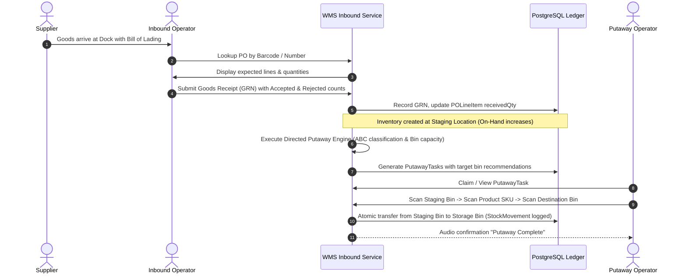
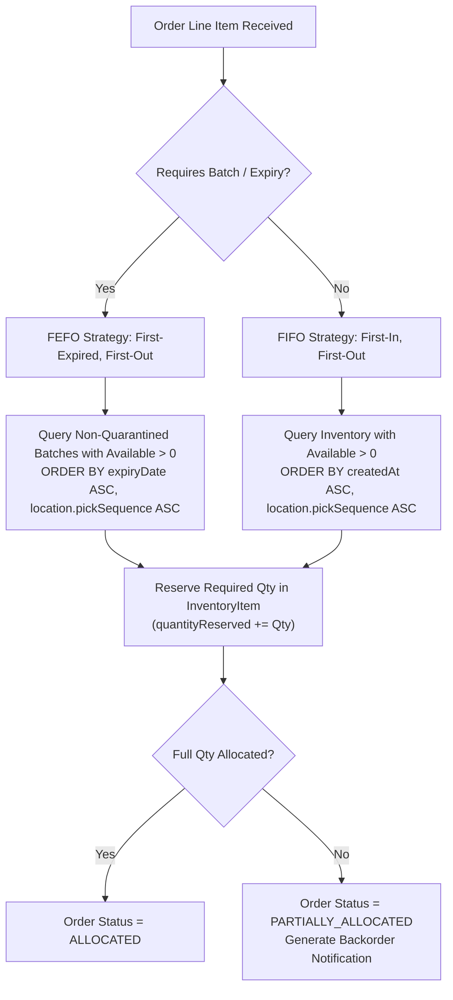
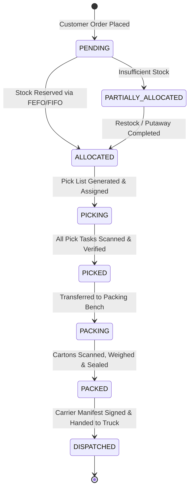

# 06. Business Rules & Operational Workflows

## 1. Core Inventory Accounting & State Rules

Physical warehouse integrity relies on unambiguous inventory state definitions. The system enforces strict mathematical equations across all inventory operations.

### 1.1 The Golden Balance Equation
For any product in any bin or warehouse:

$$\text{Quantity Available (ATP)} = \text{Quantity On-Hand} - \text{Quantity Reserved}$$

- **Quantity On-Hand ($Q_{\text{on-hand}}$):** The physical count of units currently residing in the storage bin.
- **Quantity Reserved ($Q_{\text{reserved}}$):** Units physically present in the bin that have been legally committed to active sales orders or open pick lists. These units cannot be promised to any other order.
- **Quantity Available (Available-to-Promise / ATP):** Uncommitted stock that can be sold or transferred.
- **Strict Rule:** $\text{Quantity Available} \ge 0$ at all times. The system aborts any transaction attempting to reduce $\text{Quantity Available}$ below zero.

### 1.2 Reorder & Stockout Triggers
- **Reorder Condition:** When $\text{Quantity Available} \le \text{Reorder Point}$, an automated alert is dispatched and the product is flagged on the replenishment dashboard.
- **Stockout Condition:** When $\text{Quantity Available} == 0$, the product is flagged as `OUT_OF_STOCK`, preventing outbound allocation.

---

## 2. Inbound Workflow: From PO to Putaway

### 2.1 Inbound Rules & Validation
1. **Overage Receiving Limit:** Over-delivery is blocked by default. A configurable margin (e.g., maximum 5%) can be authorized only by a Warehouse Manager.
2. **Quality Control (QC) & Quarantine:**
   - Any goods flagged as damaged during GRN intake are routed directly to the `QUARANTINE` or `RETURNS` zone.
   - Quarantined batches cannot be selected by the order allocation engine.
3. **Directed Putaway Algorithm:**
   - **Velocity Matching:** High-turnover "Fast-Mover" SKUs (Class A) are routed to low-height, near-dock pick-face bins.
   - **Storage Class Matching:** Hazardous or cold-chain products are strictly routed to zones flagged with the corresponding storage class.
   - **Volumetric Safety:** Target bin weight cannot exceed `maxWeightKg` and volume cannot exceed `maxVolumeM3`.

---

## 3. Allocation Engine: FIFO vs. FEFO Rules

When a Sales Order is allocated, the system evaluates product attributes to select the appropriate allocation strategy:

### 3.1 Allocation Safeguards
- **Expired Stock Exclusion:** Stock within $N$ days of expiration (where $N$ is product shelf-life threshold, e.g., 30 days) is automatically excluded from order allocation.
- **Lock Exclusion:** Locations flagged with `isLocked = true` (under active cycle count) are skipped during allocation.
- **Atomic Concurrency:** Allocation executes under a PostgreSQL row lock (`FOR UPDATE`) to prevent race conditions during high-volume spikes.

---

## 4. Outbound Workflow: Pick, Pack, and Ship

### 4.1 Pick-Pack-Ship Operational Rules
1. **Pick Path Optimization:** Pick tasks within a Pick List are sorted strictly by `Location.pickSequence ASC` (S-shape / serpentine traversal) to eliminate backtracking in aisles.
2. **Barcode Scan Verification:**
   - The picker must scan the Location Barcode first to verify physical presence at the correct bin.
   - The picker must scan the Product Barcode to verify correct SKU selection.
   - Mis-scans trigger an immediate visual warning and error buzzer.
3. **Short-Picking Handling:** If an item is missing from a bin during picking:
   - The task is flagged as `SHORT_PICKED`.
   - The remaining unpicked quantity is released back or transferred to an alternate bin.
   - An automated Cycle Count flag is triggered for the disputed bin to reconcile discrepancy.
4. **Packing Station Verification:**
   - Items are scanned into shipping cartons.
   - The final carton is weighed on an integrated scale; if measured weight deviates by > 5% from calculated theoretical weight, a packing supervisor inspection is required.
5. **Dispatch Finalization:**
   - Transition to `DISPATCHED` is the point of no return:
     - $Q_{\text{on-hand}} = Q_{\text{on-hand}} - Q_{\text{dispatched}}$
     - $Q_{\text{reserved}} = Q_{\text{reserved}} - Q_{\text{dispatched}}$
     - Immutable `StockMovement` recorded with `MovementType: DISPATCH_SHIPMENT`.

---

## 5. Stock Adjustments & Cycle Counting Rules

1. **Mandatory Reason Codes:** No inventory adjustment can be committed without selecting an authorized reason code (`DAMAGED_GOODS`, `EXPIRED_STOCK`, `CYCLE_COUNT_DISCREPANCY`, `THEFT_OR_SHRINKAGE`, `FOUND_STOCK`, `DATA_ENTRY_CORRECTION`).
2. **Dual-Approval Threshold:**
   - Adjustments resulting in a financial variance $\le \$250$ can be executed directly by an Inventory Controller.
   - Adjustments with variance $> \$250$ require counter-approval by a Warehouse Manager or Super Admin before ledger update.
3. **Bin Freeze During Cycle Count:** When an aisle or bin is scheduled for a physical cycle count, `Location.isLocked` is set to `true`. All pick and transfer allocations targeting that bin are suspended until count reconciliation is finalized.
