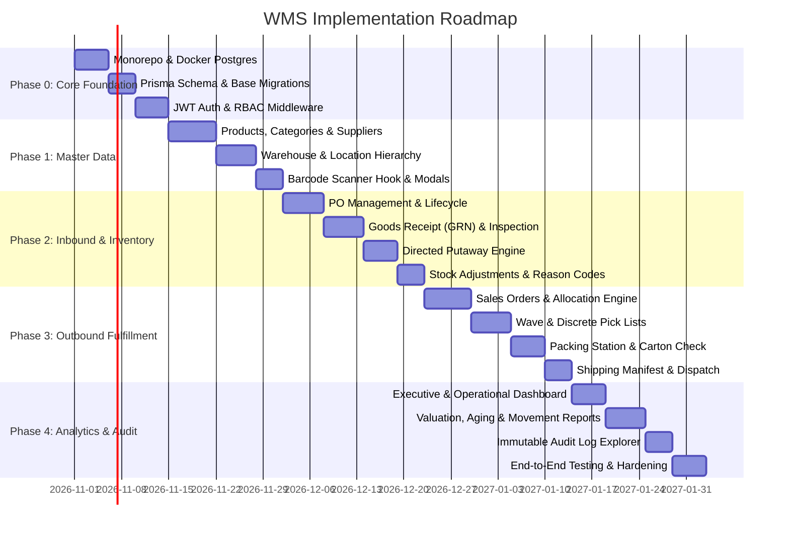

# 08. Development Roadmap & Implementation Plan

## 1. Phased Delivery Strategy

To minimize risk and deliver working software incrementally, the Warehouse Management System will be developed across 5 clearly defined phases. Each phase culminates in an end-to-end testable milestone.

---

## 2. Phase-by-Phase Deliverables

### Phase 0: Foundations & Architecture Setup
**Objective:** Establish monorepo structure, database pipeline, authentication, and core UI shell.
- Initialize monorepo with `client` (Vite + React + Tailwind + TypeScript) and `server` (Node.js + Express + TypeScript).
- Configure PostgreSQL database via Docker Compose.
- Initialize Prisma ORM, apply base schema, configure seed script with initial roles and admin user.
- Implement JWT authentication with HTTP-only refresh token rotation.
- Implement RBAC authorization middleware and React route guards.
- Setup base responsive application layouts (`DashboardLayout`, `AuthLayout`).

### Phase 1: Master Data & Spatial Location Engine
**Objective:** Enable comprehensive management of products, suppliers, warehouses, and bin hierarchy.
- **Products & Categories Module:** CRUD views, product physical specifications (dimensions, weight, storage class), category tree.
- **Suppliers Module:** Supplier master directory, vendor lead times, linked supplier SKUs and pricing.
- **Warehouses & Locations Module:** Multi-warehouse management, Zone configuration, 6-tier location generator (`Warehouse` -> `Zone` -> `Aisle` -> `Rack` -> `Shelf` -> `Bin`).
- Barcode labeling engine: Generate Code128 / QR barcodes for products and bins.
- Hardware barcode scanner listener integration in React.

### Phase 2: Inbound Operations & Inventory Control
**Objective:** Support full purchase order intake, receiving inspection, directed putaway, and inventory ledger.
- **Purchase Orders:** Creation, status progression (`DRAFT` -> `ISSUED`), supplier tracking.
- **Goods Receipt (GRN):** Dock receipt interface, line-item check, accepted vs rejected counts, batch/lot capture, manufacturing/expiry date entry.
- **Directed Putaway Engine:** Suggest optimal destination bins based on SKU velocity and bin volume constraints; putaway task assignment and confirmation scanning.
- **Inventory Ledger:** Real-time stock balance views (`On-Hand`, `Reserved`, `Available`).
- **Stock Adjustments & Transfers:** Reason-coded adjustments, manager approval workflows, inter-bin transfers.

### Phase 3: Outbound Fulfillment Engine (Pick, Pack, Ship)
**Objective:** Deliver automated order allocation and zero-error outbound picking and dispatch.
- **Sales Orders:** Order creation/import, address validation, priority queues.
- **Allocation Engine:** Automated FIFO / FEFO inventory reservation with PostgreSQL row locking (`SELECT ... FOR UPDATE`).
- **Pick Management:** Pick list generation sorted by bin `pickSequence`, mobile-friendly scan-to-pick interface with audio feedback.
- **Packing Station:** Scan-to-carton packing verification, package weight capture.
- **Shipping & Dispatch:** Carrier selection, tracking number generation, shipping manifest creation, final stock deduction.

### Phase 4: Operational Intelligence, Audit & Production Hardening
**Objective:** Provide real-time dashboards, operational reports, audit compliance, and production verification.
- **Dashboard:** Real-time KPI tiles (Stock value, Active SKUs, Inbound/Outbound velocity, Low stock alerts).
- **Reports:** Inventory Valuation (FIFO/Average), Stock Movement history, Aging analysis, Picker productivity metrics, CSV/PDF export.
- **Audit Logs:** Immutable audit log explorer with entity diff viewer.
- **Hardening:** Rate limiting, security audit, stress-testing concurrent allocation, responsive testing on rugged handheld screens.

---

## 3. Definition of Done (DoD) per Milestone

A milestone is considered complete only when:
1. All functional requirements for the module are implemented and covered with unit/integration tests.
2. Zod validation schemas are strictly enforced on all incoming API payloads.
3. Database mutations execute within atomic Prisma transactions and generate corresponding `AuditLog` and `StockMovement` records.
4. UI screens are fully responsive across both desktop (1920x1080) and rugged mobile terminals (7-inch touchscreens).
5. Code passes TypeScript strict mode compilation (`tsc --noEmit`) and ESLint checks with zero warnings.
